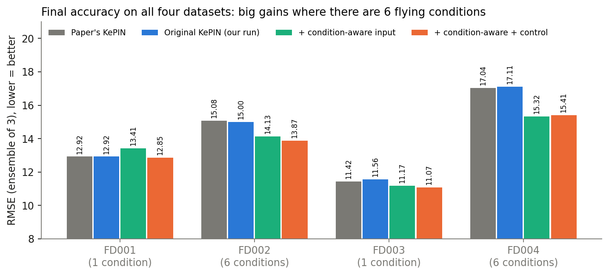
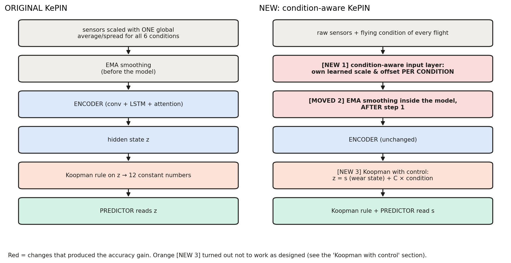

# Condition-Aware KePIN: explaining and improving a Koopman-based RUL model

This branch (`condition-aware-kepin`) contains an explainability-driven study of **KePIN**, a Koopman-enhanced network for predicting the Remaining Useful Life (RUL) of jet engines on NASA C-MAPSS. It also contains the models that came out of that study.

> **New here?** Start with the illustrated guide **[docs/KePIN_Project_Explained.pdf](docs/KePIN_Project_Explained.pdf)** (21 pages, plain English). The detailed report is in [docs/REPORT.md](docs/REPORT.md). The original KePIN README of `main` is kept as [README_KEPIN_ORIGINAL.md](README_KEPIN_ORIGINAL.md).

## Results at a glance

RMSE (lower is better), ensemble of 3 runs, same seeds and training recipe as the KePIN paper:

| Dataset | Flying conditions | KePIN (paper) | KePIN (our reproduction) | **+ condition-aware input** | **+ condition-aware + Koopman control** |
|---|---|---|---|---|---|
| FD001 | 1 | 12.92 | 12.92 | 13.41 | **12.85** |
| FD002 | 6 | 15.08 | 15.00 | 14.13 | **13.87** |
| FD003 | 1 | 11.42 | 11.56 | 11.17 | **11.07** |
| FD004 | 6 | 17.04 | 17.11 | **15.32** | 15.41 |

- **FD002/FD004** (6 flying conditions): 1.1–1.8 RMSE better than KePIN, with every seed better (p = 0.003–0.05). The NASA score improves too: FD002 869 → 825, FD004 1265 → 1043.
- **FD001/FD003** (1 flying condition): no significant change, as expected, because there is no condition noise to remove.

> **Evaluation note.** These numbers use the same model-selection procedure as the original KePIN code (`fit_enhanced`), so they compare directly with the published table. That procedure picks the best epoch, and SWA vs best weights, on the **test** set. A stricter protocol, with validation on 20% held-out training engines, is implemented as `train.py --protocol clean`. On FD002 it gives errors about 0.4–0.6 higher for every model. See [docs/REPORT.md](docs/REPORT.md), Step 5.



## Main findings

1. **KePIN's Koopman part does not drive its accuracy.** Its 12 spectral features are computed from one fixed matrix and copied to every engine (`tf.tile`), so they carry no engine-specific information. Removing Koopman completely changes RMSE by −0.27 to +0.68, which is not significant on any dataset.
2. **Explainability revealed a shortcut.** The earlier "Signal A" dynamic model followed the mix of flying conditions (R² 0.85–0.88), not engine wear (R² 0.02–0.04).
3. **Stable Koopman rules cannot represent growing wear.** This is why the "time-to-failure" rollout never crossed the failure threshold, and why training Koopman on each engine's real future made results worse.
4. **Wear model.** A Koopman rollout with a wear-accumulator mode (an eigenvalue-1 integrator with a learned wear rate) matches KePIN on all four datasets. It explains every prediction as *current health + wear rate → flights until failure*. The wear rate rises over every engine's life, ignores flying conditions, and is driven by known degradation sensors.
5. **Condition-aware KePIN (the accuracy gain).** A learned per-condition input normalisation, applied before KePIN's EMA smoothing, removes the flying-condition information from the latent state (linear R² 0.26 → 0.00) and keeps the RUL information (0.89). This gives the FD002/FD004 gains above.
6. **Honest caveat.** The "Koopman with control" split (z = s + C·u) does not produce a condition-free state. Probing shows that s still carries the condition (R² 0.97), so the gain should be credited to the condition-aware input layer.

## Architecture changes vs original KePIN



| Change | Original KePIN | This branch |
|---|---|---|
| Condition-aware input layer (new) | one global scaling for all conditions | learned scale and offset per operating condition, initialised to per-condition standardisation |
| EMA smoothing (moved) | preprocessing, before the model | fixed layer inside the model, after the condition step |
| Koopman with control (new, optional) | Koopman rule on z | z = s + C·u; Koopman losses and RUL head use s |
| Wear head (new, optional) | dense RUL head | RUL = flights until Koopman-projected health (fading modes + wear rate × k) crosses 0 |
| Fast Koopman layer (new) | K = U diag(σ) Vᵀ, eigenvalues computed numerically | eigenvalue-parameterised K = P · blockdiag(ρ R(θ)) · Pᵀ, no eigendecomposition |

With the new parts set to neutral, the condition-aware model reproduces KePIN's predictions exactly (max difference 6e-6).

## Repository layout (new on this branch)

```
dynamic_koopman/            all new code
  train.py                  trains one model / dataset / seed (all variants via flags)
  dk_model.py               KePIN with swappable Koopman layer and heads; condition-aware path
  eigen_koopman.py          fast eigenvalue-parameterised Koopman layer (static / exo / health / both)
  dk_data.py                C-MAPSS loading identical to KePIN + engine ids + per-flight operating condition
  future_trainer.py         long-horizon "future" Koopman loss (negative result, kept for reproducibility)
  analyze_wear.py           wear-model explainability (life trajectories, shortcut test, Integrated Gradients)
  analyze_condition_state.py  probes: is the latent condition-free?
  aggregate.py              results tables (mean ± std over runs + ensemble)
  queue_worker.py, prepare_dirs.py, slurm/, tasks/   SLURM task queue used for all experiments
  kepin_core/               original KePIN modules (unchanged, plus 2 documented small additions)
  results/                  per-run metrics (*_result.json) and test predictions (*_predictions.npz)
  reports/                  figure scripts and figures; reports/teaching/ builds the PDF guide
  EXPERIMENT_LOG.md         dated log of every experiment, decision and fix
signal_a_xai/               explainability analysis of the earlier Signal A model
docs/                       REPORT.md (full report), figures, KePIN_Project_Explained.pdf
```

## How to run

**Environment:** TensorFlow 2.16 / Keras 3 (see `requirements.txt`). The data comes from `code/C-MAPSS-Data` on `main`, linked from `dynamic_koopman/kepin_core/C-MAPSS-Data`.

```bash
cd dynamic_koopman

# original KePIN (reproduction), paper protocol, seed 0
python train.py --dataset FD002 --koopman svd --mode static --protocol paper --run_id 0

# condition-aware KePIN (+ Koopman with control)
python train.py --dataset FD002 --koopman svd --mode static --protocol paper --run_id 0 --cond_norm --koop_control

# wear model (Koopman rollout + wear accumulator)
python train.py --dataset FD002 --koopman eig --mode static --head wear --protocol paper --run_id 0

# KePIN with Koopman removed (ablation)
python train.py --dataset FD002 --koopman none --mode static --protocol paper --run_id 0

# stricter evaluation: add  --protocol clean   (validation on held-out training engines)
```

Outputs go to `dynamic_koopman/runs/<protocol>/<dataset>/<arm>/`. Use `python aggregate.py runs` for tables. `python aggregate.py results` rebuilds them from the committed results.

**On a SLURM cluster:** run `python prepare_dirs.py tasks/<file>.txt`, then `sbatch slurm/queue.slurm tasks/<file>.txt`. The slurm scripts contain absolute paths from our cluster; adjust `DK=` and the conda activation lines for yours.

## Limitations

- **Protocol:** the headline numbers use the original KePIN protocol (test-set model selection). Final clean-protocol runs of all models are still to do.
- **Novelty of the input layer:** per-condition normalisation is common practice on C-MAPSS. Whether the learned layer beats plain per-condition preprocessing has not yet been tested.
- **Seeds:** 3 per model, as in the paper. Differences below about 0.5 RMSE are not reliably detectable.

## Credits

This builds on the original KePIN code on `main`; see [README_KEPIN_ORIGINAL.md](README_KEPIN_ORIGINAL.md) for the paper and citation. The data is the NASA C-MAPSS turbofan degradation dataset.
