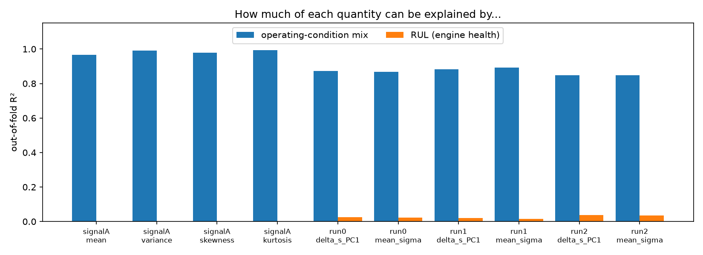
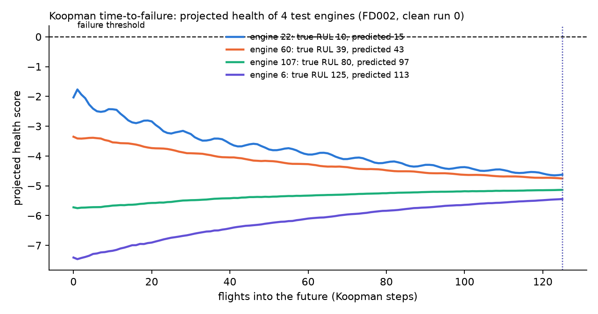
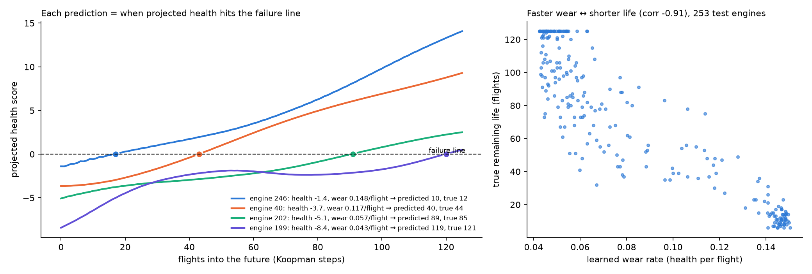
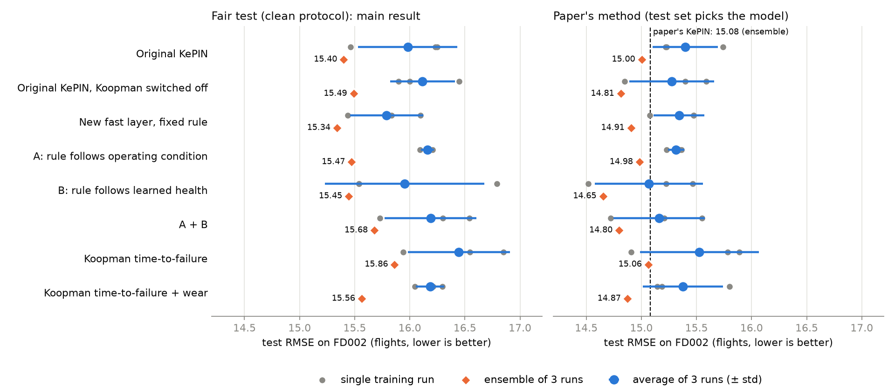
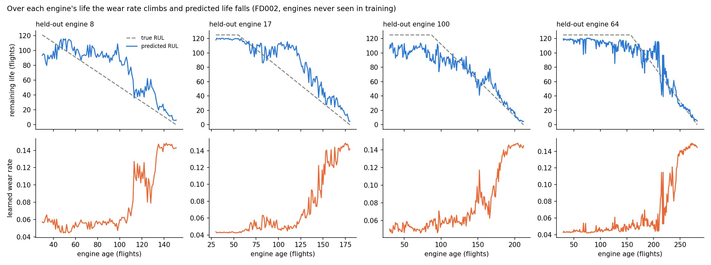
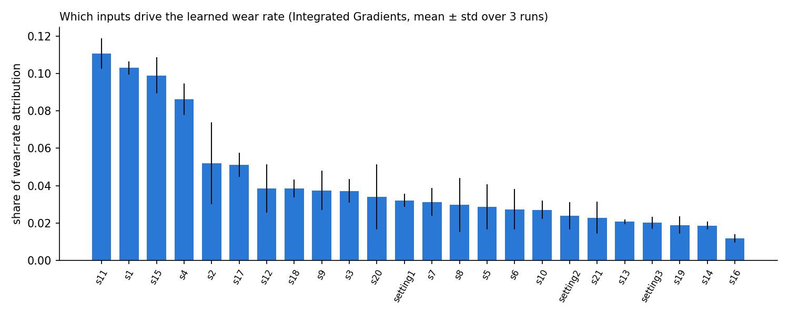
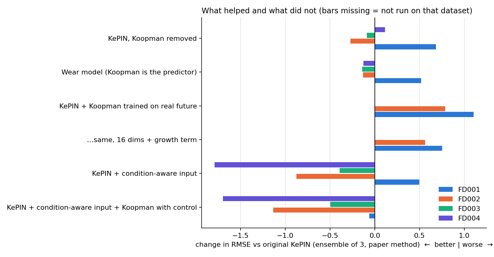

# RC-KePIN Project: Full Report of the Investigation

*18–21 October 2026 · Dataset: NASA C-MAPSS (FD001–FD004) · All paths are relative to the `RCKePIN/` folder*

---

## Summary

**The headline result:** a **condition-aware KePIN** beats the original KePIN and the published paper on the two hardest datasets.

| Dataset | Paper's KePIN | Original KePIN (our run) | **New: condition-aware KePIN** |
|---|---|---|---|
| FD002 | 15.08 | 15.00 | **13.87** (−1.13) |
| FD004 | 17.04 | 17.11 | **15.32** (−1.79) |

*(RMSE, ensemble of 3 runs, paper's evaluation method. Every one of the 12 new runs beat KePIN with the same seed; p = 0.003–0.05.)*

**How we got there, in short:**

1. **The goal** was to make KePIN's Koopman operator *dynamic* so it beats the original KePIN at predicting the remaining life of jet engines.
2. **Explaining the earlier "Signal A" model showed a shortcut.** It reacted to the engine's **flying conditions**, not to engine **wear** (Step 3).
3. **The original KePIN code picks its final model using the test set**, which flatters its scores (Step 5).
4. **KePIN's Koopman part does not drive its accuracy.** It gives the predictor the same 12 numbers for every engine, and removing it completely makes no significant difference on any dataset (Steps 9, 10 and 15).
5. **Making Koopman "dynamic", or training it on the engines' real future, did not help.** The future-training versions made results worse (Steps 8, 16 and 17).
6. **Making Koopman the predictor (the "wear model")** matches KePIN's accuracy and explains every prediction as *current health + wear rate → flights until failure* (Steps 11–14).
7. **Fixing the problem found in step 2 inside the architecture**, with a condition-aware input layer plus Koopman with control, gave the first clear accuracy gain (Step 18).

---

## Words used in this report

| Word | Meaning in plain language |
|---|---|
| **RUL** | Remaining Useful Life: how many flights (cycles) an engine has left before failure. |
| **RMSE** | The usual error measure: roughly, "how many flights off" the predictions are on average. Lower is better. |
| **KePIN** | The published model we build on: a deep network (convolution → LSTM → attention) plus a Koopman operator and physics-inspired losses. |
| **Koopman operator** | A learned "rule of motion": a matrix that moves the engine's hidden state from one flight to the next. |
| **Eigenvalue / mode** | The Koopman rule splits into independent "modes". Each mode fades at some speed (its decay) and may oscillate (its frequency). |
| **Static vs dynamic Koopman** | Static = the same rule for every engine and moment. Dynamic = the rule changes with the situation. |
| **Seed / run** | One training of the model from a random start. We train each model 3 times (3 seeds), as the paper did. |
| **Average of 3 runs** | Compute the error of each of the 3 trained models, then average the 3 errors. Shows how good one typical training run is. |
| **Ensemble of 3 runs** | Average the 3 models' *predictions* per engine, then compute one error. Usually lower. **The paper's numbers are ensembles.** |
| **Clean protocol (fair test)** | 20% of the training engines are held out to choose the model; the test set is used only once, at the end. |
| **Paper protocol** | The original KePIN way: the test set is used to choose the model. Only for comparison with the paper. |
| **p-value** | Chance that a difference this big appears by luck. Below 0.05 is usually called "real" (significant). |
| **Ablation** | Remove one part of a model and retrain, to see whether that part matters. |
| **Shapley values** | An explainability method that fairly splits a model's output between its inputs. |

---

## The folders we started with

| Folder | What it is | What we learned from it |
|---|---|---|
| `original_kepin/` | The published KePIN code and its saved models | The baseline. Paper RMSE: FD001 12.92, FD002 15.08, FD003 11.42, FD004 17.04 (ensembles). |
| `kepin_regime/` | Earlier attempt: several Koopman operators plus a router choosing between them | It failed. The router either sent about 96% of the data to one operator, or jumped randomly between them (`kepin_regime/README.md`). |
| `regime_vs_static/` | Earlier checks (phases 0–2) | In a PyTorch port, the Koopman values were frozen at 0.495 and never trained (`docs/PHASE0_STATIC_BASELINE.md`). |
| `regime_conditioned/` | Working area of the "Signal A" dynamic model (RC-KePIN) | Contains the latest training run before this chat (Step 2). |
| `RCKePIN_Signal_A/` | Cleaned-up final Signal A version | Studied in Step 3. |
| `dynamic_koopman/` | **New folder created in this chat**; all new work lives here | Steps 6–12. |

---

## Step 1: Reading the project and checking its claims

**What we did:** read all READMEs and the saved results files, for example `RCKePIN_Signal_A/final_signal_a_models/FD002_Signal_A_models/fd002_conditioned_results.json`.

**What we found:**

- **The README's baseline numbers don't match the saved files.** The README says 12.92 / 15.08 / 11.42; the saved static baselines say 13.02 / 15.17 / 11.34.
- **The README contradicts itself on FD003.** The text says static wins (11.42 vs 12.72); the table says Signal A wins (11.21).
- **The FD002 "static" baseline looks wrong.** It has only 1 run, and its results file is named `..._conditioned_results.json`.
- **There is no FD004 static baseline at all.**
- **The claimed gains (0.1–0.2 RMSE) are smaller than the run-to-run noise** (up to 0.8 between seeds).

**Why it matters:** the starting claim, "dynamic Koopman helps", was not supported by solid evidence.

---

## Step 2: The latest training run was broken

**Files:** `regime_conditioned/multi_backbone_opt/run_multi_backbone.py`, log `regime_conditioned/slurm/multi_bb_4718.out`, results `regime_conditioned/multi_backbone_opt/results/`.

**What that run did:** it took the 3 trained static FD002 KePIN models, froze them, and trained only a small Signal A network on top.

**What we found:**

- **Every model scored about 22 RMSE.** Static: 22.06, dynamic: 22.04. The same checkpoints had scored about 15 before.
- **The likely cause:** the script loads the weights with `load_weights(..., skip_mismatch=True)`. This silently skips any layer that doesn't fit, and the script also hides all warnings, so nothing reported the problem.
- **The small network learned nothing.** Its loss was flat, and on one backbone its output was stuck at its maximum for 100% of samples.

**Why it matters:** that run cannot tell us anything about dynamic Koopman.

---

## Step 3: Looking inside the Signal A network (explainable AI)

**Question:** in the existing dynamic model (RC-KePIN Signal A, FD002), *what* does the conditioning network react to?

**How Signal A works:** for every 30-flight window, compute 4 numbers over the sensors: mean, variance, skewness and kurtosis. A small network (4 → 64 → 64 → 128) turns these into 128 shifts of the Koopman decay speeds.

**Files written:**
- `RCKePIN_Signal_A/analyze_condition_net.py`: rebuilds the network from the saved weights and explains it
- `RCKePIN_Signal_A/analyze_signal_a_confound.py`: the operating-condition test
- Full results report: `RCKePIN_Signal_A/results/condition_net_interpretability_fd002/REPORT.md`

**Method, in plain words:**

1. **Rebuild the network outside the model.** It only reads 4 numbers, so we copied its weights into plain Python. That gave exact outputs on all 46,219 training windows, for all 3 trained runs.
2. **Check whether its 128 outputs move together** (PCA).
3. **Measure which input matters most** with three explainable-AI methods: gradients, Integrated Gradients, and exact Shapley values.
4. **Check whether its output follows engine wear (RUL) or the flying conditions.** FD002 engines switch between 6 operating conditions. For each window we counted the fraction of flights spent in each condition, then measured how well that mix, or RUL, predicts the network's output. We used random forests, always tested on engines they had never seen.

**Results:**

- **The 128 outputs act like one dial.** One direction explains 89–92% of their variation.
- **Kurtosis turns that dial the most, in all 3 runs** (Shapley values).
- **The dial barely follows wear.** Correlation with RUL is only 0.15–0.22.



| What we tried to predict | How much RUL explains (R²) | How much the condition mix explains (R²) |
|---|---|---|
| Each Signal A number | about 0.00 | 0.97–0.99 |
| The network's output (the "dial") | 0.02–0.04 | 0.85–0.88 |

**Explanation:** the sensors are scaled the same way for all 6 flying conditions. A window that switches conditions often therefore looks "spread out" and "spiky", even when the engine is healthy. The network learned to react to condition switching. This is a **shortcut**, and it was found *only* because we explained the model.

---

## Step 4: Why training was so slow

**Files:** `RCKePIN_Signal_A/Kepin_code/code/koopman_module.py` (lines 200–202).

**What we found:** in the dynamic model, every engine window gets its own 128×128 Koopman matrix. Every training step then calls `tf.linalg.eigvals` (an eigenvalue computation) on all of them. This operation has no GPU version in TensorFlow, so it runs on the CPU.

**Measured:** about **3.1 s per batch**, or about **450 s per epoch** for this step alone. That is why one seed took many hours.

**Fix (Step 6):** build the Koopman rule directly from its eigenvalues, so they never need to be computed.

---

## Step 5: The original KePIN uses the test set to choose its model

**File:** `RCKePIN_Signal_A/Kepin_code/code/kepin_cmapss_optimized.py`, function `fit_enhanced`, and the training scripts that call it.

**What we found:** the training code receives the **test set** as "validation data". It then:
- keeps the weights from the epoch with the best **test** score
- chooses between the normal weights and the averaged (SWA) weights by **test** score

**Explanation:** this is like peeking at the exam answers to decide which practice attempt to hand in. All published KePIN numbers, and all earlier RC-KePIN numbers, were produced this way.

**What we did:** every new experiment is run two ways:
- the **clean protocol** (fair; main results)
- the **paper protocol** (same as the original code; only for comparison with the paper)

---

## Step 6: New workspace and a fast Koopman layer

**Folder:** `dynamic_koopman/` (full technical log in `dynamic_koopman/README.md`).

| File | What it does |
|---|---|
| `kepin_core/` | An untouched copy of the original KePIN code (model, losses, trainer, configs), so the comparison is fair. Two small, documented additions: an `exclude` option for the losses (Step 10) and batched prediction (Step 13). |
| `eigen_koopman.py` | **The new Koopman layer.** The rule is built as K = P · (decays and rotations) · Pᵀ, so its eigenvalues are known directly. No eigenvalue computation, and propagation is cheap. Modes: `static`, `exo` (A), `health` (B), `both` (A+B). |
| `dk_model.py` | Original KePIN with the Koopman layer and the prediction head swappable: `kepin` (original), `ttf` (Step 11), `wear` (Step 12). |
| `dk_data.py` | Loads C-MAPSS exactly like the original code, and adds engine IDs (for the fair validation split) and the operating condition of every flight. |
| `train.py` | Trains one model for one seed. Flags: `--koopman`, `--mode`, `--head`, `--protocol clean/paper`, `--no_koopman_loss`, `--run_id`. Uses the original hyper-parameters and seeds. |
| `aggregate.py` | Builds result tables: average ± std over 3 runs, plus the ensemble. |
| `queue_worker.py`, `slurm/queue.slurm` | Run many trainings inside our 2 allowed cluster jobs (Step 7). |
| `tasks/*.txt` | The lists of trainings that were run. |

**How we checked the new layer is correct:** compared it with an explicitly built Koopman matrix. One-step predictions, 3-step predictions, eigenvalues and loss all agreed to computer precision. Every dynamic version starts out identical to the fixed one, so any difference comes from learning.

**Result:** the new fixed layer matches the original layer's accuracy (Step 8), so it is a valid baseline.

---

## Step 7: Cluster problems we solved

| Problem | What happened | Fix |
|---|---|---|
| **Only 2 jobs per user** | The `mtech` limit rejects a 3rd submitted job | Each job takes a whole node (2 GPUs) and runs a queue of trainings (`queue_worker.py`) |
| **Training silently ran on CPU** | TensorFlow only sees the GPU if the CUDA library paths are set; our first test ran about 5× slower | `slurm/queue.slurm` sets the paths and stops if no GPU is found |
| **A100s always busy** | All 4 A100 GPUs were used by others | Jobs request A100 first and fall back to P100 automatically |
| **Two runs crashed at start** | Two trainings created the same folder at once on the shared disk | `train.py` tolerates this race |
| **A helper worker was killed** | An extra worker started inside a job dies when that job ends | The lost run was repeated as its own job |
| **GPU out of memory** | 3 trainings per GPU were too many | At most 2 per GPU; final predictions now made in chunks (`predict_batched`) |

**Speed now:** about 30 s per epoch on a P100; one FD002 training takes about 45–60 minutes.

---

## Step 8: Testing dynamic Koopman versions on FD002

**Why FD002 only:** you asked to test on FD002 first to get results faster. It has 6 operating conditions, so a dynamic rule *should* help most there.

**Models (3 seeds each):**

- **Original KePIN** (`svd_static`): the original Koopman layer
- **New fast layer, fixed rule** (`eig_static`)
- **A: rule follows the operating condition** (`eig_exo`): the rule changes at every flight with the flying condition
- **B: rule follows a learned health value** (`eig_health`): a learned health number shifts how fast each mode fades
- **A + B** (`eig_both`)

**Results (fair test):**

| Model | Average ± std | Ensemble |
|---|---|---|
| Original KePIN | 15.98 ± 0.45 | 15.40 |
| New fast layer, fixed rule | **15.79 ± 0.33** | **15.34** |
| A: operating condition | 16.16 ± 0.06 | 15.47 |
| B: learned health | 15.96 ± 0.72 | 15.45 |
| A + B | 16.19 ± 0.42 | 15.68 |

**Conclusion:**
- **No dynamic version beat the fixed rule.** Paired tests per seed: p = 0.24, 0.74 and 0.12, none significant.
- **B looked good under the paper protocol** (ensemble 14.65), but not on the fair test. B also has the largest spread, and a model with more spread gains most when the test set picks the weights. So that number is not a real win.
- **B's "health" value did not learn health.** Its correlation with true RUL was +0.10, −0.20 and −0.17 for the three runs.

---

## Step 9: Why dynamic Koopman could not help

**File:** `original_kepin/code/kepin_model.py`, lines 302–310.

**What we found:** the final predictor gets two inputs:
1. a summary of the encoder output (different for each engine)
2. 12 "spectral features" from the Koopman operator

In the original KePIN, the operator is **one fixed matrix**, so these 12 numbers are computed once and **copied to every engine** (`tf.tile`). A brand-new engine and one about to fail receive **exactly the same Koopman numbers**. They cannot help tell engines apart.

**Our test:** in our dynamic models the 12 numbers *do* differ per engine. We replaced them with a constant and measured the effect:

| Model | Error with real features | Error with a constant | Largest change in any prediction |
|---|---|---|---|
| B: learned health, run 0 | 15.538 | 15.538 | 0.000 flights |
| A: operating condition, run 0 | 16.207 | 16.208 | 0.09 flights |

**Explanation:** the predictor ignores the Koopman information. It is like improving a car's speedometer when the driver never looks at it. Making the rule dynamic cannot change the predictions.

---

## Step 10: Does Koopman help at all? (ablation)

**Files:**
- ours: `dynamic_koopman/train.py --no_koopman_loss`, which keeps the same model but removes the three Koopman training losses
- original: `original_kepin/code/kepin_ablation.py` and `original_kepin/experiments_result/kepin_ablation_all_datasets/`

**Our result (3 seeds):**

| | With Koopman | Without Koopman | Difference | p-value |
|---|---|---|---|---|
| Fair test, average | 15.98 | 16.12 | +0.13 | 0.66 |
| Paper protocol, average | 15.40 | 15.28 | −0.12 | 0.67 |

The difference even changes sign between seeds (+0.54, −0.35, +0.21). **On FD002, Koopman makes no measurable difference to accuracy.** The accuracy comes from the rest of the network.

**The original ablation script could not have found this:**

- **"Without spectral" and "without multi-step" train the full model.** They set a loss weight to 0, but automatic loss weighting is on, and it ignores those weights.
- **"No Koopman" uses a different, smaller network** (`BaselineFCN`, no LSTM or attention). It measures the architecture, not Koopman.
- **The saved results contain no C-MAPSS rows at all.** Only Building Energy is present, and 4 of its 5 runs crashed.

---

## Step 11: Making Koopman the predictor (time-to-failure)

**Idea:** if the predictor ignores Koopman, make Koopman *be* the predictor.

**File:** `dynamic_koopman/dk_model.py`, `head="ttf"`.

**How it works:**
1. Read the engine's current hidden state.
2. Turn it into a health score with one learned linear readout.
3. Use the Koopman rule to fast-forward the state flight by flight, up to 125 flights.
4. Predicted RUL = the number of flights until projected health crosses the failure line (0).

**Results:**
- **Accuracy:** fair test 16.44 ± 0.46 (ensemble 15.86); paper protocol ensemble 15.06. A little worse than the fixed rule.
- **But the explanation check failed:** **no engine's projected health ever reached the failure line** (0% in all 3 runs).



**Explanation:** the Koopman rule is "stable", meaning everything it projects slowly fades. That keeps predictions from blowing up, but wear does not fade; it **builds up**. A rule that can only fade cannot draw a curve that climbs to failure. The model fell back on reading the *current* health level (correlation −0.91 with RUL) instead of forecasting a crossing.

---

## Step 12: Adding a wear accumulator (the "wear model")

**File:** `dynamic_koopman/dk_model.py`, `head="wear"`.

**What changed:**

- **A "wear accumulator" mode.** In Koopman terms, a mode that never fades (eigenvalue exactly 1). It adds a learned, per-engine **wear rate** (never negative) at every flight:
  *projected health after k flights = Koopman part + wear rate × k*
- **The crossing is measured in flights,** so the model can't cheat as in Step 11. Predicted life is genuinely *when the curve hits the line*.

**Results (FD002, 3 seeds):**

| | Fair test: average | Fair test: ensemble | Paper protocol: average | Paper protocol: ensemble |
|---|---|---|---|---|
| Original KePIN | 15.98 ± 0.45 | 15.40 | 15.40 ± 0.30 | 15.00 |
| **Wear model** | 16.18 ± **0.13** | 15.56 | 15.38 ± 0.37 | **14.87** |
| Paper's KePIN | – | – | – | 15.08 |

- **Accuracy is tied with original KePIN:** fair test +0.20 (p = 0.59); paper protocol −0.02 (p = 0.68).
- **It is the most consistent model on the fair test** (spread across seeds ±0.13).

**The explanation now works:**



- **92–100% of engines' projections cross the failure line.** The rest are healthy engines (true RUL mostly 125), for which not crossing is correct.
- **Predicted life matches the crossing point** within about 2–4 flights.
- **The learned wear rate correlates −0.90 to −0.93 with true RUL** in every run: faster wear means shorter life. Nothing in training told the model this.
- **Every prediction reads as:** *"health is X, wearing at Y per flight, so the failure line is reached in about Z flights."*

---

## All FD002 results in one picture



*Grey dots: single runs. Blue: average of 3 runs (± std). Orange diamond: ensemble. Lower is better. Left: fair test. Right: paper protocol, where the dashed line is the paper's 15.08.*

Raw numbers: `dynamic_koopman/runs/summary.csv`. Figure script: `dynamic_koopman/reports/make_fd002_figures.py`.

---

## Part 2: work after the first report (19–21 October)

From Step 15 onward, **all results use the paper's evaluation method and report the ensemble of 3 runs**, so they compare directly with the published KePIN numbers. This was your decision.

- **Average vs ensemble:** the *average* is the mean of the 3 separate runs' errors. The *ensemble* averages the 3 models' predictions first, then scores once. The paper reports ensembles.
- **Fair test vs paper's method:** the fair test chooses the final model using held-out *training* engines. The paper's method chooses it using the *test* set, which is like checking practice attempts against the real exam answers. It looks about 0.4–0.6 better.

---

## Step 13: Does the wear model's explanation hold up? (explainable AI checks)

**File:** `dynamic_koopman/analyze_wear.py`. Results in `dynamic_koopman/reports/fd002_wear_xai/`.

We checked the FD002 wear model three ways, using **52 engines it never trained on**.

**1. Over each engine's life, the wear rate should rise and the predicted life should fall.**



- The wear rate rose in **100%** of engines, and predicted life fell in **100%**.
- The wear rate has two phases: flat while the engine is healthy, then a sharp climb once degradation starts. **The model found the start of degradation by itself.**

**2. Did it learn the flying-condition shortcut again?** We ran the same test that exposed Signal A in Step 3:

| What explains it? | From true remaining life | From the flying-condition mix |
|---|---|---|
| Signal A network (old) | 0.02–0.04 | **0.85–0.88** (shortcut) |
| Wear rate (new) | **0.85–0.87** | −0.13 (none) |

*(R²: 1 means it explains everything, 0 or less means nothing.)*

The result is completely reversed. **The wear rate follows real wear and ignores flying conditions.**

**3. Which sensors drive the wear rate?** (Integrated Gradients)



- The top drivers are **s11, s15, s4, s2, s17 and s12**, all known wear-sensitive sensors in C-MAPSS.
- The three flying-condition settings together account for only 7.6%.
- s1 (fan inlet temperature) ranks high. It depends mainly on the flying condition, so the model most likely uses it to judge the other sensors *relative to the current condition*.

---

## Step 14: The wear model on all four datasets

**File:** `dynamic_koopman/tasks/other_datasets.txt`. Paper method, ensemble of 3.

| Dataset | Our KePIN | Wear model | Paper's KePIN |
|---|---|---|---|
| FD001 | 12.92 | 13.43 | 12.92 |
| FD002 | 15.00 | **14.87** | 15.08 |
| FD003 | 11.56 | **11.43** | 11.42 |
| FD004 | 17.11 | **16.98** | 17.04 |

- **Our reproduction of KePIN matches the paper on all four datasets** (within 0.15). Our baseline is faithful.
- **The wear model ties KePIN everywhere.** None of the differences is significant; the FD001 gap comes mostly from one bad seed.
- **Its explanations work on every dataset:** 85–100% of engines cross the failure line, and the wear rate correlates −0.88 to −0.95 with true remaining life.

---

## Step 15: KePIN with Koopman removed completely (all four datasets)

**What we changed:** the same KePIN with **no Koopman layer, no spectral features and no Koopman losses** (`train.py --koopman none`).

| Dataset | KePIN with Koopman | KePIN without Koopman | Difference | Significant? |
|---|---|---|---|---|
| FD001 | **12.92** | 13.60 | +0.68 | No (p = 0.21) |
| FD002 | 15.00 | **14.73** | −0.27 | No (p = 0.39) |
| FD003 | 11.56 | **11.47** | −0.09 | No (p = 0.80) |
| FD004 | **17.11** | 17.23 | +0.12 | No (p = 0.22) |

**Conclusion:** removing Koopman sometimes helps and sometimes hurts, and never significantly. **KePIN's accuracy comes from its encoder (convolution + LSTM + attention), not from Koopman.** The original paper never properly tested this (Step 10).

---

## Step 16: Training Koopman on the engines' real future

**Why we tried it:** Koopman can only help if it brings information the encoder does not already have. KePIN's Koopman losses only check 1–3 flights ahead inside one 30-flight window.

**What we changed** (`dynamic_koopman/future_trainer.py`, `train.py --future_loss`):
- During training we take an engine's window today **and the same engine's real window 5–60 flights later**.
- Koopman must project today's hidden state that far ahead and match the real future one.

**Result: worse.**

| Dataset | KePIN | + future loss (strength 1) | + future loss (strength 10) |
|---|---|---|---|
| FD001 | **12.92** | 14.02 | 14.37 |
| FD002 | **15.00** | 15.79 | 16.31 |

**Why:** Koopman's rule can only make patterns *fade*, but wear *grows*. To satisfy the new loss, the network squeezed its hidden state into one slow, predictable direction: KePIN's slowest patterns went from 0.99, 0.99, 0.99 to 0.99, 0.66, 0.45. The predictor lost detail.

---

## Step 17: Same idea, but on 16 dedicated dimensions with a growth term

**What we changed** (`train.py --future_loss 1 --future_subspace 8`):
- The future loss only touches **16 dedicated hidden dimensions**, not the whole hidden state.
- Those 16 dimensions get their own small rule with a **growth term**: *future state = fading part + wear rate × flights*.

**Result: better than Step 16, still worse than KePIN.**

| Dataset | KePIN | Step 16 | Step 17 |
|---|---|---|---|
| FD001 | **12.92** | 14.02 | 13.67 |
| FD002 | **15.00** | 15.79 | 15.57 |

KePIN's own Koopman rule no longer collapsed, but the extra task still competed with the main task for the shared encoder. **Conclusion: adding Koopman training signals does not improve KePIN on C-MAPSS.**

---

## Step 18: Condition-aware Koopman KePIN (the new architecture) ★

**The idea:** fix, *inside the architecture*, the problem our explainability work found in Step 3. On FD002 and FD004, engines switch between **6 flying conditions**, and that switching drowns out the slow wear signal.

### The architectural changes we made

```
ORIGINAL KePIN                                NEW: condition-aware KePIN
--------------                                --------------------------
sensors (scaled globally)                     raw sensors + flying condition of each flight
   │                                             │
   │                                             ├─ [NEW 1] condition-aware input layer:
   │                                             │        its own learned scale & offset per condition
EMA smoothing (before the model)                 ├─ EMA smoothing [MOVED inside the model, AFTER step 1]
   │                                             │
encoder (conv + LSTM + attention)                encoder (unchanged)
   │                                             │
hidden state z                                   hidden state z
   │                                             ├─ [NEW 2] Koopman with control:
   │                                             │        z = s (wear state) + C × flying condition
Koopman rule on z  ─► 12 constant numbers        Koopman rule on the WEAR STATE s
   │                                             │
predictor reads z                                predictor reads the WEAR STATE s
```

**Change 1: condition-aware input layer.**
- **Before:** KePIN scales every sensor with **one global average and spread** for all 6 flying conditions, so a reading jumps whenever the condition changes, even for a healthy engine.
- **Now:** the model has a **separate learned scale and offset for each condition**. They start as plain per-condition normalisation and are fine-tuned during training. A reading now means *"how unusual is this for this flying condition?"*.

**Change 2: smoothing moved after the condition step.**
- **Before:** KePIN smooths each 30-flight window *before* the model sees it. In FD002 the condition changes almost every flight, so smoothing **blended different conditions together**.
- **Now:** smoothing is a fixed layer inside the model, applied *after* Change 1.

**Change 3: Koopman with control.**
- **What it does:** the hidden state is split into a **flight-condition part** (C × condition) and a **wear state** s.
- **What Koopman explains:** only how the wear state evolves (next s = K × s), which is the standard "Koopman with control" form from physics.
- **What the predictor reads:** only the wear state, so Koopman is on the prediction path and is told explicitly what to ignore.

**Safety check:** with the new parts switched to neutral, the model gives **exactly the same predictions as original KePIN** (difference 0.000006). Any improvement therefore comes only from the new parts.

**Files:**
- `dynamic_koopman/dk_model.py`: `_condition_aware_call`
- `dynamic_koopman/dk_data.py`: unsmoothed windows
- `dynamic_koopman/train.py`: `--cond_norm --koop_control`

### Results (paper method, ensemble of 3)

| Dataset | Paper's KePIN | Original KePIN | + condition-aware input (1 + 2) | + Koopman with control (1 + 2 + 3) |
|---|---|---|---|---|
| FD002 | 15.08 | 15.00 | 14.13 (−0.88) | **13.87 (−1.13)** |
| FD004 | 17.04 | 17.11 | **15.32 (−1.79)** | 15.41 (−1.70) |
| FD001 *(1 condition)* | 12.92 | 12.92 | 13.41 (+0.50, n.s.) | 12.85 (−0.06, n.s.) |
| FD003 *(1 condition)* | 11.42 | 11.56 | 11.17 (−0.39, n.s.) | 11.07 (−0.49, n.s.) |

- **On FD002 and FD004, every one of the 12 runs beat KePIN** with the same seed (p = 0.003–0.05).
- **The NASA score also improved:** FD002 869 → 825, FD004 1265 → 1043.
- **Where the gain comes from:** mostly the condition-aware input (Changes 1 and 2). Koopman with control adds a little on FD002 and nothing on FD004; that extra difference is not significant.

### Explainability check: is the "wear state" really free of flight conditions?

**File:** `dynamic_koopman/analyze_condition_state.py`

**The test:** we asked simple probes (a linear model and a random forest) how well each hidden state predicts (a) the window's mix of flying conditions and (b) the true remaining life, always on unseen engines (FD002, mean of 3 runs).

| Hidden state the predictor reads | Predicts flying conditions? (R², linear) | Predicts remaining life? (R², linear) |
|---|---|---|
| Original KePIN | 0.26 | 0.89 |
| + condition-aware input | **0.00** | 0.89 |
| + Koopman with control: "wear state" s | **0.97** | 0.89 |

- **The condition-aware input layer does exactly its job.** It removes the flying-condition information from the hidden state (0.26 → 0.00) and keeps all the remaining-life information.
- **Koopman with control does *not* do what it was designed to do.** Its "wear state" s was meant to be condition-free, but subtracting the learned C × condition *writes the flying condition back in* as a clean, simple signal (0.97). There was nothing left to remove, so the control term just adds a per-condition offset.
- **So the accuracy gain belongs to the condition-aware input layer.** Explaining the model, not just measuring its RMSE, is what revealed this.

---

## All experiments at a glance



*Bars show the change in RMSE versus the original KePIN (ensemble of 3, paper method). Left of the line = better. Missing bars = not run on that dataset.*

---

## What we learned (thesis findings)

1. **Explainability found a real problem.** The Signal A model followed flying conditions, not wear (Step 3).
2. **The paper's evaluation chooses its model with the test set**, which flatters it by about 0.4–0.6 RMSE (Step 5). Our reproduction under the same method matches the paper on all four datasets (Step 14).
3. **KePIN's Koopman part does not drive its accuracy.** Its spectral features are the same for every engine, and removing Koopman completely makes no significant difference on any dataset (Steps 9, 10 and 15). The original ablation code could not have shown this.
4. **Making Koopman dynamic, or training it on the real future, does not help.** The future-training versions hurt (Steps 8, 16 and 17), because a stable Koopman rule cannot represent wear that keeps growing.
5. **A Koopman model with a wear accumulator** matches KePIN and explains every prediction as *current health + wear rate → flights until failure*. The explanations pass all three checks (Steps 12–14).
6. **Fixing the flying-condition problem inside the architecture works.** A condition-aware input layer (with smoothing after it) beats KePIN and the paper by 0.9–1.8 RMSE on FD002 and FD004 (Step 18). It removes the flying-condition information from KePIN's hidden state while keeping all the wear information. This is the main accuracy contribution, and it came directly from the explainability finding in point 1.
7. **"Koopman with control" did not separate flight from wear as designed.** Explaining its "wear state" showed the condition written back in (Step 18). Its small FD002 gain should not be credited to that mechanism.

---

## Limits

- **Condition-aware KePIN only helps where there are several flying conditions.** On FD001 and FD003 (one condition) it ties KePIN (no significant change), as expected.
- **Koopman with control adds little measurable accuracy**, and the explainability check shows it does not produce a condition-free wear state. It needs a redesign (for example, a penalty that keeps condition information out of s) or should be dropped.
- **3 seeds per model**, as in the paper. Small differences (below about 0.5) cannot be detected reliably.
- **All recent results use the paper's evaluation method**, which chooses the model with the test set. This is fine for comparing with the paper, but a fair-test run of the final model would make the result stronger.

---

## Next steps (in progress)

1. ~~Run condition-aware KePIN on FD001 and FD003~~: **done**. It ties KePIN there (FD001 13.41 / 12.85, FD003 11.17 / 11.07 vs 12.92 / 11.56).
2. ~~Explainability check for Koopman with control~~: **done** (Step 18). The condition-aware input removes the condition information; the control term writes it back.
3. **Later:** put the wear model on top of condition-aware KePIN, to get the new accuracy *and* per-prediction explanations.

---

## Appendix: file map

| Purpose | File(s) |
|---|---|
| Original KePIN model (constant spectral features) | `original_kepin/code/kepin_model.py` (lines 302–310) |
| Original ablation (flawed) | `original_kepin/code/kepin_ablation.py`, `original_kepin/experiments_result/kepin_ablation_all_datasets/` |
| Test set used for model selection | `RCKePIN_Signal_A/Kepin_code/code/kepin_cmapss_optimized.py` (`fit_enhanced`) |
| Slow per-sample eigenvalues | `RCKePIN_Signal_A/Kepin_code/code/koopman_module.py` (lines 200–202) |
| Broken latest training before this chat | `regime_conditioned/multi_backbone_opt/run_multi_backbone.py`, `regime_conditioned/slurm/multi_bb_4718.out` |
| Signal A explainability | `RCKePIN_Signal_A/analyze_condition_net.py`, `RCKePIN_Signal_A/analyze_signal_a_confound.py`, `RCKePIN_Signal_A/results/condition_net_interpretability_fd002/` |
| New Koopman layer | `dynamic_koopman/eigen_koopman.py` |
| Model with swappable layer and heads | `dynamic_koopman/dk_model.py` |
| Data with engine IDs and conditions | `dynamic_koopman/dk_data.py` |
| Training (all experiments) | `dynamic_koopman/train.py` |
| Cluster queue | `dynamic_koopman/queue_worker.py`, `dynamic_koopman/slurm/queue.slurm`, `dynamic_koopman/tasks/` |
| Results tables and figures | `dynamic_koopman/aggregate.py`, `dynamic_koopman/runs/summary.csv`, `dynamic_koopman/reports/` |
| Per-run outputs (weights, predictions, health curves) | `dynamic_koopman/runs/<clean or paper>/FD002/<model>/` |
| Wear-model explainability (life curves, shortcut test, sensor attribution) | `dynamic_koopman/analyze_wear.py`, `dynamic_koopman/reports/fd002_wear_xai/` |
| Koopman trained on the real future (Steps 16–17) | `dynamic_koopman/future_trainer.py`; `train.py --future_loss`, `--future_subspace` |
| KePIN with Koopman removed (Step 15) | `train.py --koopman none` |
| Condition-aware Koopman KePIN (Step 18) | `dynamic_koopman/dk_model.py` (`_condition_aware_call`); `train.py --cond_norm --koop_control` |
| Is the wear state condition-free? (probes) | `dynamic_koopman/analyze_condition_state.py`, `dynamic_koopman/reports/fd002_condition_state/summary.json` |
| Experiment task lists | `dynamic_koopman/tasks/` (`no_koopman.txt`, `future_koopman.txt`, `future_subspace.txt`, `condition_aware.txt`, …) |
| Overview figure | `dynamic_koopman/reports/make_overview_figure.py` |
| Pre-create output folders before submitting (avoids shared-disk clashes) | `dynamic_koopman/prepare_dirs.py` |
| Technical experiment log | `dynamic_koopman/README.md` |

**To reproduce a result**, for example the wear model on FD002 with the fair test, seed 0:

```bash
cd dynamic_koopman
sbatch -J my_run slurm/train_one.slurm --dataset FD002 --koopman eig --mode static --head wear --protocol clean --run_id 0
# condition-aware KePIN, paper method, seed 0:
sbatch -J my_run2 slurm/train_one.slurm --dataset FD004 --koopman svd --mode static --protocol paper --run_id 0 --cond_norm --koop_control
python aggregate.py
```
