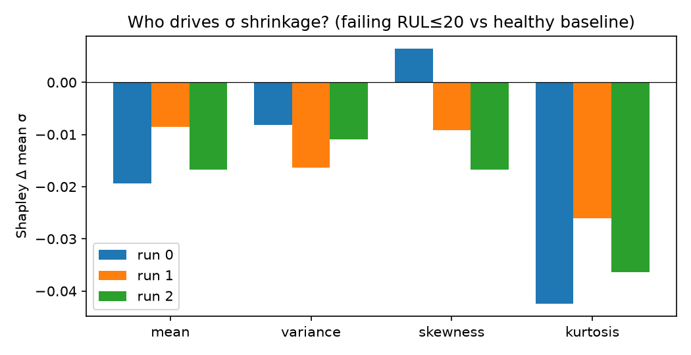
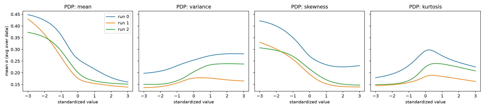
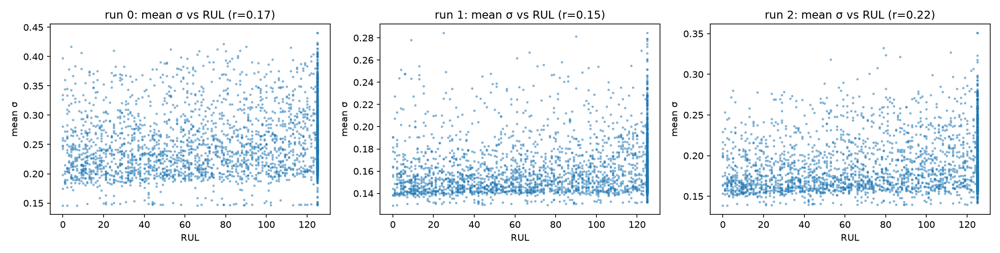

# What the RC-KePIN Condition Network Really Learned (FD002)

*Date: 18 October 2026 · Models: `final_signal_a_models/FD002_Signal_A_models/` (runs 0, 1, 2)*

## The short answer

On the FD002 engine dataset, the condition network was supposed to **sense engine wear** and make the model "forget faster" as the engine approaches failure.

When we opened the network up, we found it is **mostly reacting to the flying conditions the engine is in**, not to how worn out the engine is:

- The engine's remaining life explains only **2–4%** of what the network does.
- The mix of operating conditions explains **85–89%** of it.

This is a classic case of a model learning a **shortcut**. It is a useful result for explainable AI, because the explanation methods exposed something the accuracy numbers (RMSE) could not.

---

## 1. The model in plain words

RC-KePIN predicts how many flights (cycles) a jet engine has left before it fails. This number is called the Remaining Useful Life (RUL). The model reads the last 30 cycles of 21 sensors and 3 operating settings.

The idea under test:

1. **Signal A.** From those 30 cycles, compute four summary numbers:
   - **mean**: the average level of the readings
   - **variance**: how spread out the readings are
   - **skewness**: how lopsided the readings are
   - **kurtosis**: how often extreme, spiky readings occur

   The hope is that these four numbers describe the engine's current "health state".
2. **Condition network.** A small neural network (4 → 64 → 64 → 128 neurons) reads Signal A. It outputs 128 adjustments, called **Δs**, one for each internal "memory channel" of the model.
3. **Decay speed σ (sigma).** Each adjustment sets how quickly its channel forgets the past. A **low σ means faster forgetting**, which should match an engine that is wearing out quickly.
4. **The claim we are checking.** As the engine nears failure, Signal A should change, the network should lower σ, and the model should react to faster wear.

The three trained FD002 models score a test RMSE of 15.17, 15.95 and 15.15 (14.94 when averaged).

**About FD002:** it is a NASA dataset in which engines fly under **six different operating conditions** (combinations of altitude, speed and throttle), switching between them from one flight to the next. All engines fail in the same way.

---

## 2. Finding 1: the 128 outputs behave like a single dial

The network produces 128 adjustments, but they mostly move **together**.

We used PCA, a method that finds the main directions in which a set of numbers varies. The single strongest direction explains **89–92%** of all the variation in the 128 outputs:

| Run | Share explained by the top direction | Effective number of independent "dials" |
|---|---|---|
| 0 | 89% | 1.6 |
| 1 | 89% | 1.6 |
| 2 | 92% | 1.5 |

**In plain words:** the network learned one knob, roughly "speed up or slow down all memory channels together". This makes it easy to explain, because we only need to understand what turns that one knob.

The network also often hits its limits. **48–75%** of outputs sit at the lowest allowed value (Δs = −2). In that state the network is not adjusting anything; it is pushed as far as it can go.

---

## 3. Finding 2: kurtosis turns the dial the most

We asked: when an engine goes from **healthy** to **nearly failed** (20 or fewer cycles left), how much of the drop in σ does each of the four inputs cause?

We used **Shapley values**, which come from game theory. They share the total change fairly between the four inputs, and the shares add up exactly to the total.



| Run | mean | variance | skewness | **kurtosis** | Total drop in average σ |
|---|---|---|---|---|---|
| 0 | −0.019 | −0.008 | +0.006 | **−0.042** | −0.064 |
| 1 | −0.008 | −0.016 | −0.009 | **−0.026** | −0.060 |
| 2 | −0.017 | −0.011 | −0.017 | **−0.036** | −0.081 |

**Kurtosis (spikiness) is the biggest driver in all three runs.** A second method, Integrated Gradients, agrees.

The plot below shows how the average σ changes as we slide one input from low to high while keeping the data otherwise as it is. This is called a partial-dependence plot. All three runs have the same shape:

- a higher mean or skewness gives a lower σ (faster forgetting)
- variance has a weak effect
- kurtosis has a peak in the middle



So far, this looks like a nice, consistent explanation. The next finding shows why it can't be taken at face value.

---

## 4. Finding 3: the dial follows flying conditions, not engine health

**First warning sign.** If the dial tracked engine wear, average σ should fall clearly as remaining life falls. It doesn't: the correlation with RUL is only **0.15–0.22**, and the scatter plots show no clear trend.



**What it tracks instead.** In FD002, the engine switches between 6 operating conditions. Two things make this matter:

- All sensors were rescaled with one global average and spread, instead of separately for each condition.
- The 3 operating-setting columns were included as inputs.

So when a 30-cycle window **switches between conditions a lot**, its readings jump around. Signal A then reports high variance and spikiness, even though the engine itself is fine.

**The test.** For every window, we recorded what fraction of its 30 cycles was spent in each of the 6 conditions (the "condition mix"). We then measured how well two things can predict the network's behaviour: the condition mix, or the remaining life (RUL). The score is R²: 1.0 means perfect prediction and 0 means no information.


| What we tried to predict | R² from remaining life | R² from condition mix |
|---|---|---|
| Each Signal A number (mean, variance, skewness, kurtosis) | about 0.00 | **0.97–0.99** |
| The network's main dial (3 runs) | 0.02–0.04 | **0.85–0.88** |
| Average σ, i.e. decay speed (3 runs) | 0.02–0.04 | **0.85–0.89** |

**Conclusion:** Signal A on FD002 is almost entirely a measure of "how much did the operating condition change in this window". The condition network learned to respond to that, not to engine wear.

The README's statement that the network "shrinks σ as the engine degrades" is therefore not supported on FD002. The small drop in σ near failure (about 0.06–0.08) is tiny next to the swings caused by condition changes.

---

## 5. How we reached these conclusions, step by step

1. **Rebuilt the network outside the model.** The condition network only reads the 4 Signal A numbers. So we copied its saved weights out of the `.weights.h5` files and rebuilt it in plain NumPy. This gave us exact outputs and exact gradients on all **46,219** training windows, with no retraining.
2. **Looked at the outputs (PCA).** We checked whether the 128 outputs vary independently or together (Finding 1).
3. **Measured each input's importance.** We used three standard explainable-AI methods:
   - **Gradients**: how sensitive the output is to a tiny nudge of each input.
   - **Integrated Gradients**: adds up those nudges along the path from a healthy engine to a failing one.
   - **Exact Shapley values**: with only 4 inputs, all 16 combinations can be tried.

   For both Integrated Gradients and Shapley, the reference "healthy" engine was the average Signal A of all windows with RUL = 125, the maximum value. We checked that the attributions add up to the total change, which they did (error below 0.0005).
4. **Plotted input-to-output curves** (partial dependence), to see the shape of each effect.
5. **Checked consistency across the 3 trained runs.** A real explanation should not change much from one run to another. The kurtosis-first result held for all three.
6. **Ran a confound test** (Finding 3):
   - We rebuilt each window's condition mix from the raw NASA files.
   - We checked that the windows line up exactly with the training data (all 46,219 RUL labels match).
   - We trained random-forest models to predict Signal A and the network's outputs from either the condition mix or RUL.
   - To avoid cheating, the models were always scored on **engines they had never seen** (5-fold split by engine).

---

## 6. Limits of this analysis

- **Saturated outputs.** Where an output is stuck at its limit (48–75% of cases), gradients are zero. Gradient-based explanations therefore describe only the outputs that are not stuck.
- **Correlated inputs.** Mean and skewness move together (correlation −0.88), and so do variance and kurtosis (−0.71). When two inputs move together, it is hard to say how the credit should be split between them. So "kurtosis rather than variance" is less certain than "spikiness/variance as a group".
- **Small reconstruction difference.** Our rebuilt Signal A differs slightly from the saved one, by at most 0.24 on the standardized scale. The labels match exactly, and this is far too small to change a gap of 0.03 vs 0.87.
- **Scope.** Only FD002 was analysed. FD001 and FD003 have a single operating condition, so this particular confound cannot happen there.

---

## 7. What to do next

1. **Fix Signal A on FD002/FD004.**
   - Rescale the sensors separately for each operating condition. This is standard practice for these two datasets.
   - Remove the 3 setting columns before computing the four moments.
   - Retrain, then rerun these scripts to check whether the dial now follows RUL.
2. **Run the same analysis on FD001.** With one operating condition, it is a clean test of whether the network can track wear when the shortcut is not available.
3. **Use this as a thesis result.** "Explanation methods reveal that the regime conditioner encodes operating conditions, not degradation" is a clear, defensible XAI contribution. Pair it with the before/after comparison from step 1.

---

## Files

| File | What it is |
|---|---|
| `../../analyze_condition_net.py` | Rebuilds the network; PCA, gradients, Integrated Gradients, Shapley values, partial dependence |
| `../../analyze_signal_a_confound.py` | The operating-condition confound test |
| `summary.json` | All numbers behind Findings 1 and 2, per run |
| `confound_operating_conditions.json` | All numbers behind Finding 3 |
| `*.png` | The figures used in this report |

To reproduce, run from `RCKePIN_Signal_A/` (CPU only, a few minutes):

```bash
python3 analyze_condition_net.py
python3 analyze_signal_a_confound.py
```
